# Physical Design Automation Final Project Presentation Draft

This markdown is designed for a 10-minute English presentation about the current solver for ICCAD Contest Problem E: Early Floorplanning with Global Route.

Use the text under **Slide Content (English)** as the PPTX slide content. The **Detailed Chinese Explanation** sections are speaker-preparation notes in Traditional Chinese and do not need to appear on the actual slides.

---

## Slide 1 - Early Floorplanning with Global Route

**Slide Content (English)**

- Physical Design Automation Final Project
- ICCAD Contest Problem E: Early Floorplanning with Global Route
- Goal: build a CPU-only C++17 solver that generates legal floorplans, global routing channels, and routed paths
- Current focus: route-aware placement search with pluggable placement engines

**Visual Suggestion**

- A simple left-to-right pipeline: `CSV problem -> EFGR solver -> CFG solution`

**Detailed Chinese Explanation**

這張是開場頁。你要先講清楚這不是單純做 block packing，而是「early floorplanning」階段就要把 global route 的影響納入。也就是說，placement 的好壞不是只看面積或 block overlap，還要看 channel 是否足夠、bundle 是否能連通、soft block 是否因 feedthrough 需要更多面積。

目前專案的定位是 CPU-only、C++17、標準函式庫為主的 contest solver。它會從官方 CSV 讀入問題，產生 `.cfg`，內容包含 outline、block placement、channel rectangles，以及 routing path。你可以在開場最後一句帶出主軸：「我的架構重點是把 placement representation 和 search/evaluation 解耦，讓不同 placement engine 可以在同一個 route-aware evaluator 下比較。」

---

## Slide 2 - Problem Statement: Goal

**Slide Content (English)**

- Official goal: perform early floorplanning when only high-level chip specs are available
- Plan block locations, routing channels, and global signal paths before detailed RTL/netlist information exists
- Optimize:
  - chip outline area
  - global routing wirelength
  - channel and feedthrough resource cost
- Satisfy all placement, routing, and output-format constraints

**Visual Suggestion**

- A chip outline with blocks, whitespace channels, and global routing paths

**Detailed Chinese Explanation**

這張補上官方 problem statement 的「為什麼」。Problem E 的情境是 IC 專案很早期，還沒有完整 RTL 或 netlist，只知道 IP/block 的估計面積、shape constraint、interface/bus connection demand，以及一些外部封裝或 edge location 限制。這時候要先做 early floorplanning，幫 market team、SSA 和 physical design team 判斷 chip area、routing feasibility、channel bottleneck 和後續設計風險。

你可以把這頁講成：「本題不是等 detailed placement/routing 後才處理 routing，而是在 floorplanning 階段就要同時決定 block layout 和 global route resource。」官方目標是完成初步 block 擺放、routing channel 規劃、PATH 連線，並同時降低 chip area 與 wirelength / routing cost。

---

## Slide 3 - Official Input and Output

**Slide Content (English)**

- Input CSV contains:
  - `BLOCK` table: area, width, height, aspect-ratio range, block type
  - `LOCATION` and optional `PORT EDGE` constraints for edge blocks
  - feedthrough conversion-rate table
  - `OUTLINE` max width and height
  - `alpha` for wirelength weighting
  - on-chip connection matrix with net counts
- Output `.cfg` must contain:
  - `OUTLINE`: final floorplan rectangle
  - `BLOCK`: each block's lower-left coordinate and size
  - `CHANNEL`: generated whitespace rectangles
  - `PATH`: net count plus ordered block/channel edge references
- Output path edge IDs: left = 1, top = 2, right = 3, bottom = 4

**Detailed Chinese Explanation**

這頁把官方 input/output 說完整。input CSV 主要有三部分：第一是 block table，描述每個 block 的面積、固定寬高或 aspect ratio range、block type、LOCATION、PORT EDGE，以及 feedthrough conversion rate；第二是 OUTLINE，給定最大可用 chip width/height；第三是 connection matrix，矩陣中的數字代表兩個 block 間需要多少條 signal nets。

output 則是 `.cfg`。它不是只輸出 block placement，還要輸出 channel 和 PATH。`OUTLINE` 是最後宣告的 floorplan rectangle；`BLOCK` 要列每個 block 的左下角座標和寬高；`CHANNEL` 要列每個 channel rectangle；`PATH` 則要描述每組 routed nets 經過哪些 block/channel edge。官方格式要求每個 section 都用 `END` 結尾，PATH 要包含 net 數量，edge id 採 output convention：left 1、top 2、right 3、bottom 4。這些格式錯誤會直接 fail。

---

## Slide 4 - Constraints and Evaluation Metrics

**Slide Content (English)**

- Legal constraints:
  - every block must be rectangular, inside the outline, and non-overlapping
  - Macro and Edge blocks have fixed dimensions and cannot be rotated
  - Edge blocks must be flush with the chip boundary and satisfy official `LOCATION` regions
  - multiple edge `LOCATION` tokens are AND constraints
  - all on-chip connections must be globally routed with no open routes
- Routing-resource constraints:
  - channels have 25 nets/um capacity per direction
  - soft blocks may be used as feedthrough resources with area inflation
  - hard/edge blocks are not feedthrough resources
- Evaluation objective:

```text
cost = outline_area + alpha * routed_wirelength + penalties
```

- Penalty conditions: channel overflow, feedthrough overflow
- Fail conditions: format error, block overlap, open routing, outline violation
- Runtime guideline: all testcases must finish within 2 hours; GPU acceleration is not supported

**Detailed Chinese Explanation**

這張是官方 constraint 和 evaluation metrics 的摘要。placement 合法性包含：所有 block 必須在 outline 內、不得重疊、且只能是矩形。Macro/Edge block 的尺寸固定，Q&A 也確認不允許旋轉。Edge block 必須完全貼齊 chip boundary，且 LOCATION 以 12 個等分區域定義；如果 LOCATION 是 `TL,LT` 這種多 token，官方 Q&A 說是 AND，不是 OR，也就是要同時滿足，通常代表角落限制。

routing 方面，所有 on-chip interconnection 都必須有 global routing，不能 open。Channel 的 capacity 是 25 nets/um，而且水平與垂直方向各自計算容量。Soft block 可以當 feedthrough resource，但必須依 feedthrough conversion rate 增加面積；Hard block 和 Edge block 不允許 feedthrough。Q&A 說 channel overflow 和 feedthrough overflow 是依 overflow/誤差程度扣分，不是 fail；但 format failed、block overlap、routing open、outline violation 都是 fail condition。

evaluation 的主體可以講成 `outline_area + alpha * routed_wirelength + penalties`。官方 statement 用 guiding points 計算 routed path 的 Manhattan / HPWL-style wirelength，並加上 alpha 權重。這正好呼應我們 solver 的 `cheapScore()` 和 `exactScore()`：cheap score 快速近似，exact score 會真的呼叫 router，把 routed wirelength、open route、channel overflow、feedthrough mismatch 都算進來。

---

## Slide 5 - Solver Architecture

**Slide Content (English)**



```mermaid
flowchart LR
    CSV["Official CSV"] --> IO["io.cpp: parseProblem"]
    IO --> MODEL["model.hpp: Problem / Placement / RoutingResult"]
    MODEL --> SEARCH["search.cpp: simulated annealing"]
    SEARCH --> ENGINE["placement_engine.cpp: SP / B*-Tree / Hybrid"]
    ENGINE --> EVAL["eval.cpp: cheapScore / exactScore"]
    EVAL --> ROUTING["routing.cpp: channels + shortest paths"]
    ROUTING --> VALIDATE["validate.cpp: legality checks"]
    VALIDATE --> CFG["io.cpp: writeCfg"]
```

- `model.hpp` is the shared contract between all modules
- `main.cpp` owns CLI orchestration and diagnostics
- `placement_engine.*` makes placement representation pluggable
- `routing.cpp`, `eval.cpp`, and `validate.cpp` are shared by every engine

**Detailed Chinese Explanation**

這頁就是 zoom-out 架構圖。你可以照流程講：`main.cpp` 先 parse CLI 和 input CSV，資料進入 `Problem` model。接著 `search.cpp` 負責 simulated annealing，但它不直接知道候選解是 Sequence-Pair 還是 B*-Tree，而是透過 `PlacementEngine` interface 操作。decode 出 placement 後，`eval.cpp` 先 cheap score，必要時 exact score，exact score 會呼叫 `routing.cpp`。

這個架構的重點是「同一個 evaluator 比較不同 placement representation」。也就是 `sp`、`bstar`、`hybrid` 都走相同 `Problem`、`Placement`、`RoutingResult`、`cheapScore`、`exactScore`、`validateSolution`、`writeCfg`。這讓比較比較公平，也方便之後加新 engine。

---

## Slide 6 - End-to-End Algorithm Flow

**Slide Content (English)**

1. Parse the official CSV into a `Problem`
2. Create an initial placement state using the selected engine
3. Decode the state into block rectangles
4. Run simulated annealing:
   - mutate placement state
   - decode candidate
   - evaluate cheap score
   - accept or reject by temperature
5. Periodically run exact routing evaluation
6. Cache exact results by geometry key
7. Validate the best exact candidate and write `.cfg`

**Detailed Chinese Explanation**

這頁可以當作整場 presentation 的演算法總覽。先講 input parse，再講 engine 建 initial state，接著 SA 每輪 mutate。每個 candidate 都會 decode 成 placement rectangles，因為 routing 和 scoring 都需要幾何座標。

SA 接受準則是典型的 simulated annealing：如果 candidate 比目前好就接受；如果比較差，也可能依照 `exp(-delta / temperature)` 接受，避免卡在 local minimum。temperature 會用 cooling factor 逐步降低。比較特別的是 exact routing 不會每輪都跑，而是固定 interval 或 candidate 看起來有潛力時才跑，並且用 placement geometry key cache，避免同一組幾何重複跑 router。

---

## Slide 7 - Placement Engine Interface

**Slide Content (English)**

- Shared interface:
  - `initialState(problem, rng)`
  - `mutate(problem, state, rng)`
  - `decode(problem, state)`
  - `isValidState(problem, state)`
  - `seedFromPlacement(problem, placement, rng)`
- Shared state includes:
  - Sequence-Pair permutations
  - B*-Tree parent/left/right arrays
  - Soft-block aspect ratios
  - Edge-block location choices
- CLI modes: `--engine sp`, `--engine bstar`, `--engine hybrid`

**Detailed Chinese Explanation**

這頁說明為什麼 current architecture 比早期單一 B*-Tree 更有彈性。`PlacementEngine` 是抽象介面，search loop 只知道它可以 initial、mutate、decode、validate state，不需要知道內部 representation。

`PlacementState` 同時容納 Sequence-Pair 的兩個 permutation、B*-Tree 的 node/parent/left/right/root，以及共用的 soft aspect ratio 和 edge location choice。這樣一來，edge anchor 和 soft shaping 不會被寫死在某一個 engine 裡，而是作為 shared placement behavior 被所有 engine 使用。

---

## Slide 8 - Search Strategy: Cheap vs Exact Evaluation

**Slide Content (English)**

- Cheap score runs on every candidate:
  - outline area
  - overlap and outline penalties
  - weighted center-distance wire proxy
- Exact score runs selectively:
  - periodic interval
  - promising cheap-score candidate
  - cached by rounded placement geometry
- Exact score calls global routing and adds:
  - routed wirelength
  - open-route penalty
  - channel overflow penalty
  - feedthrough mismatch penalty

**Detailed Chinese Explanation**

這頁要講效能 trade-off。router 比 cheap score 貴很多，因為它要 extract channels、建 adjacency graph、對每個 bundle 做 shortest path，還要更新 channel usage 和 feedthrough。因此程式採用 two-level evaluation：cheap score 用來快速探索，exact score 用來校準和選 final best。

你可以說這是「route-aware but runtime-conscious」的設計。它沒有每個 move 都精確繞線，但也不完全忽略 routing。`exact_interval` 控制多久精確評估一次，而 placement key cache 可以降低重複幾何造成的浪費。

---

## Slide 9 - Sequence-Pair Engine

**Slide Content (English)**

- Represents movable blocks with two permutations
- Pairwise order determines horizontal or vertical constraints
- Decode flow:
  - build horizontal and vertical constraint edges
  - solve longest-path style coordinates
  - place blocks with contour-based repair
- Mutations:
  - swap in positive sequence
  - swap in negative sequence
  - swap in both sequences
  - perturb soft aspect ratio
  - change legal edge-block location
- Strength: broad global topology exploration

**Detailed Chinese Explanation**

Sequence-Pair 是比較偏 global exploration 的 representation。兩個 permutation 中，一對 block 的相對順序會決定它們是左右關係還是上下關係。程式 decode 時會建立 horizontal/vertical constraints，透過多 pass 更新 x/y 座標，類似 longest path 的概念。

這個 engine 的優點是 topology 覆蓋範圍大，比較容易探索不同 block 相對順序。缺點是 pairwise relation 是 `O(n^2)`，而且 move 影響可能比較全域，所以需要 search temperature 幫助穩定收斂。

---

## Slide 10 - B*-Tree Engine

**Slide Content (English)**

- Represents movable blocks as a tree
- Edge blocks are anchored outside the tree by official boundary constraints
- Decode flow:
  - traverse from root
  - left child starts to the right of parent
  - right child aligns with parent x-position
  - contour placement resolves vertical stacking and overlap
- Mutations:
  - swap node labels
  - move a leaf to a new parent slot
  - perturb soft aspect ratio
  - change legal edge-block location
- Strength: compact local refinement

**Detailed Chinese Explanation**

B*-Tree 比較適合做 compact local refinement。樹的 left/right child 代表相對擺放方式，decode 時用 contour 概念把 block 放到不重疊的位置。程式中的 edge blocks 不放進 movable tree，而是在 base placement 階段根據 LOCATION anchor 到邊界，這樣可以避免 edge constraint 只靠 penalty。

目前 B*-Tree 的 mutation 比較保守：有 swap node labels、move leaf、soft aspect ratio perturbation、edge location choice。這讓 tree validity 比較容易維持，但也表示未來可以加更強的 subtree move 或更好的 SP-to-B*-Tree conversion。

---

## Slide 11 - Hybrid Placement Mode

**Slide Content (English)**

- Hybrid mode combines complementary strengths:
  1. Run Sequence-Pair search for global topology
  2. Convert the best SP placement into a B*-Tree seed
  3. Run B*-Tree search for compact refinement
  4. Keep the best exact-routed candidate from both phases
- Same evaluator, validator, and CFG writer are reused
- Current seed conversion sorts blocks by placement coordinates

**Detailed Chinese Explanation**

Hybrid 是目前最有故事性的 mode。它先用 Sequence-Pair 找比較好的 global topology，再把最好的 placement seed 給 B*-Tree 做 local refinement。這符合兩個 representation 的強項：SP 探索範圍廣，B*-Tree compact 能力好。

程式裡 hybrid 會把 iteration 大致分成兩段：前半跑 SP，後半跑 B*-Tree，B*-Tree seed 由 SP best placement 轉換而來。目前 conversion 是 practical baseline，主要用座標排序建立合法初始 B*-Tree，不是完整從 adjacency 推論 parent-child。你可以把這當成 future improvement 的伏筆。

---

## Slide 12 - Global Routing Evaluator

**Slide Content (English)**

- Channel extraction:
  - collect outline boundaries and every block x-edge
  - sweep adjacent x-strips
  - subtract covered y-intervals to emit empty channel rectangles
- Routing graph:
  - nodes are blocks plus channels
  - edges exist when rectangles touch with positive shared length
- Bundle routing:
  - Dijkstra-style shortest path
  - channel-only first
  - soft-block feedthrough fallback
  - large bundles split into up to 8 PATH chunks
- Accounting:
  - routed wirelength
  - directional channel usage and overflow
  - soft feedthrough area mismatch

**Detailed Chinese Explanation**

這頁是 routing 的技術核心。`extractChannels()` 先收集 outline 左右界和所有 block 的 x/x+w，形成 vertical strips。每個 strip 裡，把被 block 覆蓋的 y interval 扣掉，剩下的空白 rectangle 就是 channel。

接著 router 把 blocks 和 channels 都當 graph nodes。如果兩個 rectangle 接觸且共用邊長大於 0，就加 graph edge。對每個 connection bundle，先嘗試 channel-only path；如果連不起來，第二 pass 允許 soft block 當 transit，也就是 feedthrough。large bundle 會切成最多 8 份，讓 route 可以分散到不同 channel，降低 overflow。

---

## Slide 13 - Validation, Evidence, and Next Steps

**Slide Content (English)**

- Validation checks:
  - all blocks stay inside outline
  - no block overlap
  - fixed Macro/Edge dimensions are preserved
  - Edge LOCATION and PORT edge constraints are respected
  - every route is closed and uses valid edge IDs
- Fresh-run evidence from all runnable official inputs in `test/`:

| Testcase        | Engine    | Iters | Channels |           Score |      Wirelength |    Overflow | Open | Validation |
| --------------- | --------- | ----: | -------: | --------------: | --------------: | ----------: | ---: | ---------- |
| 20260414 case00 | `bstar` |   500 |       11 | `7.56297e+06` | `5.44727e+06` |       `0` |    0 | ok         |
| 20260608 port   | `bstar` |   500 |        4 | `3.05911e+09` |      `394098` | `3059.02` |    0 | ok         |

- Engine comparison summary: `bstar` currently gives the best score on both official runnable testcases with these parameters
- Extended 20260608 search improves overflow by about 5.3%, but does not eliminate congestion
- Runtime note: current solver logs optimization metrics, but not wall-clock runtime
- Next steps:

  - negotiated congestion history
  - stronger B*-Tree subtree moves
  - better SP-to-B*-Tree conversion
  - multi-seed search and visual debugging

**Detailed Chinese Explanation**

最後一頁收斂在「目前做到了什麼」和「還能怎麼變強」。validation 會檢查 outline、overlap、fixed dimensions、edge location、PORT edge、route 是否 open，以及 PATH edge id 是否在 1 到 4。這讓輸出的 `.cfg` 至少有內部 legality guard。

表格更新成目前 repo 裡可執行的兩個官方輸入 fresh run 結果：`20260414 case00` 和 `20260608 port`。這裡主頁放 `bstar` 的代表性結果，因為它在兩個 testcase 以這組參數都有目前最佳 score，而且 validation 都是 ok、open route 都是 0。你可以補一句：完整三 engine 矩陣和 extended iteration sweep 放在 appendix，避免主投影片塞太多數字。

對 `20260414 case00`，`bstar` 在 500 iterations 下沒有 channel overflow，score 約 `7.56e+06`。對 `20260608 port`，把 `bstar` 從 50 iterations 加長到 500 iterations 後，channel overflow 從 `3230.48` 降到 `3059.02`，約改善 5.3%；1000 和 5000 iterations 在同 seed 下沒有再進一步改善。因此這裡的誠實說法是：增加 iteration 有幫助，但仍不能消除 overflow。這剛好可以銜接 future work：目前 router/evaluator 能偵測 congestion，但還沒有完整 negotiated rip-up/reroute 或 congestion-history repair。最後也要提醒聽眾，目前 solver log 沒有正式記錄 wall-clock runtime，因此這裡列的是 solver 已輸出的 optimization metrics，而不是時間 benchmark。

---

# Appendix A - Source Map for Review

**Core source files**

- `src/main.cpp`: CLI, engine selection, diagnostics, final validation/write
- `src/model.hpp`: shared data structures and geometry helpers
- `src/io.cpp`: CSV parser and `.cfg` writer
- `src/search.hpp`, `src/search.cpp`: search options, simulated annealing, exact-score cache, hybrid mode
- `src/placement_engine.hpp`, `src/placement_engine.cpp`: `PlacementEngine`, Sequence-Pair backend, B*-Tree backend
- `src/routing.hpp`, `src/routing.cpp`: channel extraction, adjacency graph, bundle routing, routing accounting
- `src/eval.hpp`, `src/eval.cpp`: cheap and exact score composition
- `src/validate.hpp`, `src/validate.cpp`: internal legality checks

**Design and plan documents**

- `docs/official/E_20260608.pdf`
- `docs/official/E_QA_20260608.pdf`
- `docs/superpowers/specs/2026-05-14-v1-btree-ca-sa-periodic-router-design.md`
- `docs/superpowers/specs/2026-06-14-long-term-placement-engine-design.md`
- `docs/superpowers/plans/2026-06-14-20260608-spec-routing-performance.md`

**Regression scripts**

- `test/run_case00.sh`
- `test/run_20260608_regressions.sh`
- `test/run_placement_engine_regressions.sh`

---

# Appendix B - Fresh Testcase Results

The current repository has two runnable official-style input files under `test/`:

- `test/E_testcase_20260414.xlsx - case00.csv`
- `test/E_testcase_20260608_port.csv`

The following results were freshly run with:

- `bash test/run_case00.sh`
- `bash test/run_20260608_regressions.sh`
- direct `sp / bstar / hybrid` engine runs

The solver log reports optimization metrics but does not yet report wall-clock runtime.

## Official Script Results

| Testcase        | Engine    | Iters | Exact evals |           Score |      Wirelength | Channel overflow | Feedthrough mismatch | Open routes | Validation |
| --------------- | --------- | ----: | ----------: | --------------: | --------------: | ---------------: | -------------------: | ----------: | ---------- |
| 20260414 case00 | `bstar` |   500 |          40 | `7.56297e+06` | `5.44727e+06` |            `0` |                `0` |           0 | ok         |
| 20260608 port   | `bstar` |    50 |          13 | `3.23056e+09` |      `376952` |      `3230.48` |                `0` |           0 | ok         |

## Extended 20260608 Iteration Sweep

The 20260608 testcase was rerun with more iterations to check whether additional search can remove channel overflow. The best observed result improves overflow but does not eliminate it.

| Engine     | Iters | Exact evals | Channels |           Score | Wirelength | Channel overflow | Feedthrough mismatch | Open routes | Validation |
| ---------- | ----: | ----------: | -------: | --------------: | ---------: | ---------------: | -------------------: | ----------: | ---------- |
| `bstar`  |    50 |          13 |        4 | `3.23056e+09` |   `376952` |      `3230.48` |                `0` |           0 | ok         |
| `bstar`  |   500 |         116 |        4 | `3.05911e+09` |   `394098` |      `3059.02` |                `0` |           0 | ok         |
| `bstar`  |  1000 |         226 |        4 | `3.05911e+09` |   `394098` |      `3059.02` |                `0` |           0 | ok         |
| `bstar`  |  5000 |        1129 |        4 | `3.05911e+09` |   `394098` |      `3059.02` |                `0` |           0 | ok         |
| `hybrid` |   500 |         102 |        4 | `3.05911e+09` |   `394098` |      `3059.02` |                `0` |           0 | ok         |
| `hybrid` |  1000 |         183 |        4 | `3.05911e+09` |   `394098` |      `3059.02` |                `0` |           0 | ok         |
| `sp`     |  1000 |         177 |        4 | `3.10588e+09` |   `389421` |      `3105.79` |                `0` |           0 | ok         |

## Three-Engine Comparison

| Testcase | Engine     | Iters | Exact evals | Channels | Routes |           Score |    Outline area |      Wirelength |    Overflow | FT mismatch | Open | Validation |
| -------- | ---------- | ----: | ----------: | -------: | -----: | --------------: | --------------: | --------------: | ----------: | ----------: | ---: | ---------- |
| case00   | `sp`     |   500 |          98 |       13 |     13 | `8.29953e+06` | `6.47352e+06` | `9.13006e+06` |       `0` |       `0` |    0 | ok         |
| case00   | `bstar`  |   500 |          40 |       11 |     13 | `7.56297e+06` | `6.47352e+06` | `5.44727e+06` |       `0` |       `0` |    0 | ok         |
| case00   | `hybrid` |   500 |         135 |       11 |     13 | `8.26371e+06` | `6.47352e+06` | `8.95096e+06` |       `0` |       `0` |    0 | ok         |
| 20260608 | `sp`     |    50 |          12 |        4 |      3 | `3.29066e+09` |       `12000` |      `370943` | `3290.57` |       `0` |    0 | ok         |
| 20260608 | `bstar`  |    50 |          13 |        4 |      3 | `3.23056e+09` |       `12000` |      `376952` | `3230.48` |       `0` |    0 | ok         |
| 20260608 | `hybrid` |    50 |          12 |        4 |      3 |   `3.249e+09` |       `12000` |      `375108` | `3248.92` |       `0` |    0 | ok         |

**Presentation takeaway:** all three engines generate internally valid routed outputs with zero open routes on both runnable official inputs. With this parameter set, `bstar` is the current best-scoring engine on both testcases. More iterations reduce 20260608 channel overflow from `3230.48` to `3059.02`, but the testcase still exposes significant congestion, which supports the next-step focus on stronger congestion-aware routing and search.

---

# Appendix C - Likely Q&A and Recommended Answers

## Q1. Why not run exact routing on every simulated annealing move?

**Recommended Answer (English)**

Exact routing is much more expensive than geometry-only scoring because it extracts channels, builds a rectangle adjacency graph, routes every bundle, and updates congestion and feedthrough accounting. The solver therefore uses cheap scoring for every move and exact routing only periodically or for promising candidates, with a geometry cache to avoid repeated route evaluations.

**中文補充**

如果被問到這題，重點是「不是忽略 routing，而是用分層評估控制 runtime」。這是 contest solver 很合理的折衷。

## Q2. Why support both Sequence-Pair and B*-Tree?

**Recommended Answer (English)**

Sequence-Pair is useful for global topology exploration, while B*-Tree is useful for compact local refinement. By putting both behind the same `PlacementEngine` interface, the solver can compare them under the same route-aware evaluator and combine them in hybrid mode.

**中文補充**

這題可以回到架構價值：抽象介面讓不同 representation 共用 search/eval/write pipeline，不會為了比較 engine 寫出兩套 solver。

## Q3. Is the router an official detailed router?

**Recommended Answer (English)**

No. It is an internal global-routing evaluator designed for early floorplanning. It extracts channel rectangles from placement whitespace, routes bundle demands over a rectangle adjacency graph, and measures wirelength, overflow, open routes, and soft feedthrough mismatch. A full negotiated rip-up/reroute router is future work.

**中文補充**

要誠實說這是 evaluator / heuristic router，不是完整商用 detail router。這樣比較不會被追問時失分。

## Q4. What is the current biggest limitation?

**Recommended Answer (English)**

The biggest limitation is that cheap scoring still has a weak congestion prediction, so many candidates require exact routing to reveal channel overflow. Improving congestion-aware proxy features and adding negotiated history would likely improve both quality and runtime.

**中文補充**

這題可以把 limitation 接到 future work，顯示你知道下一步不是盲目增加 iterations，而是讓 evaluator 和 search 更 routing-aware。
